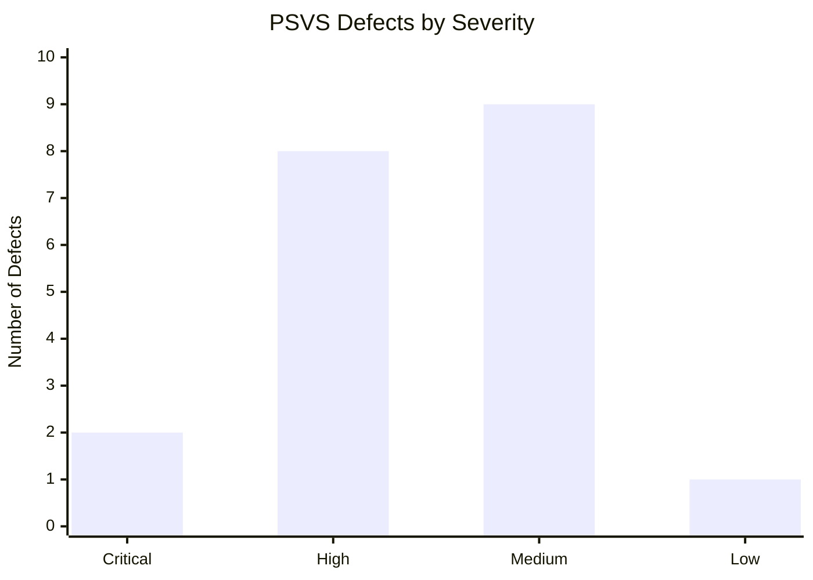

# PSVS Defect Analysis Summary

## 1. Overview

The initial review examined the 12 informal requirements of the Polar Seed Vault System. It identified 20 candidate defects involving unclear wording, missing operational rules, verification gaps, and interactions between requirements.

The log is an initial analysis and should be refined during peer review.

## 2. Counts by Primary Category

| Primary Category | Defect Count |
|---|---:|
| Incompleteness | 7 |
| Non-verifiability | 3 |
| Vagueness | 3 |
| Contradiction | 2 |
| Ambiguity | 2 |
| Redundancy | 1 |
| Missing timing constraint | 1 |
| Missing data definition | 1 |
| **Total** | **20** |

Each finding is counted once using its primary category, even where a secondary category is also applicable.

## 3. Counts by Severity

| Severity | Defect Count |
|---|---:|
| Critical | 2 |
| High | 8 |
| Medium | 9 |
| Low | 1 |
| **Total** | **20** |

## 4. Severity Assessment

- **Critical:** DF-08 and DF-12 concern ownership/emergency-release authorization and temperature-rule conflicts.
- **High:** These findings include authorization, emergency auditing, maintenance controls, viability criteria, withdrawal quotas, and audit integrity.
- **Medium:** These findings largely concern missing definitions, operational behavior, and verification criteria.
- **Low:** DF-04 concerns potential redundancy between the general and quantified capacity statements.

## 5. Chart

The following Mermaid chart summarizes defect counts by severity.

## 6. Priority Recommendations

1. Resolve the S4/S5 emergency-release authorization conflict.
2. Clarify the S7/S8 maintenance temperature exception.
3. Define depositor authorization and mandatory audit records.
4. Make viability thresholds, response times, and withdrawal accounting measurable.
5. Complete peer review and update the counts if findings are added, merged, or rejected.

## 7. Limitations

The findings are based on the informal requirement text only. They do not establish that a real implementation has failed. Severity, category, and uniqueness should be reviewed and approved before the defect log is finalized.
